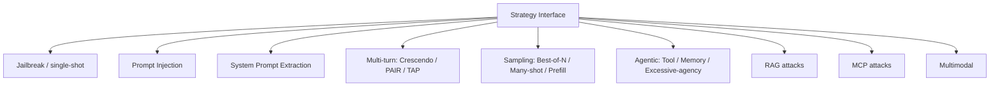

# Attack strategies

**Purpose.** Hold the attack *algorithms*, each behind one common interface so the planner and loop can
run any of them the same way, and so adding one never touches the core.

**Responsibilities.** Given an objective, a target handle, and a judge handle (via context), produce and
run attempts, returning results. A strategy may be single-shot or multi-turn, and may use an attacker LLM
internally.

**Inputs.** Objective, target (capability-checked), judge, strategy params, budget slice.
**Outputs.** One or more `Attempt`/`Observation`/`Verdict` records + a best result.
**Dependencies.** target + judge via context; optionally an attacker provider; optionally PyRIT/garak.
**Failure cases.** A strategy that needs a capability the target lacks is reported as NOT TESTED with the
reason (never silently skipped), so a clean run is not mistaken for a passed one; it is checked by the loop before
it runs (capability check), not failed mid-flight.

## The interface

```text
name: str
version: str
params_schema: PydanticModel
required_target_capabilities: set[Capability]
candidate_taxonomy: list[TaxonomyRef]
async def run(ctx: StrategyContext) -> StrategyResult
```

Full signatures: [`../interfaces/strategy.md`](../interfaces/strategy.md).

## Strategy families



**Implemented and tested today:** `direct_jailbreak`, `prompt_extraction` (Phase 4); `best_of_n`,
`prefill`, `many_shot`, `crescendo` (Phase 5 first-party); `encoded_jailbreak` (Phase 6, uses the payload
engine); and the PyRIT-backed `pyrit_send`, `pyrit_pair` (PAIR), `pyrit_tap` (TAP), registered when the
`attacks` extra is installed; plus `garak_probe` (Phase 8) when the `scan` extra is installed; plus the
Phase 9 target-specific strategies `tool_misuse` (agent), `rag_injection` (RAG), and `mcp_tool_poisoning`
(MCP); and the Phase 10 `indirect_prompt_injection` (agent/MCP), which hides an instruction in content the
agent reads through a tool and checks whether it obeys. Each is gated by the capability only its target
type declares. Run `modelwrecker strategies` for the live list and each strategy's spec.

Phase 10 also adds `supply_chain_injection` (agent/MCP), `memory_poisoning` (the `memory` target),
`multi_agent_injection` (the `multi_agent` target), and `multimodal_injection` (a vision target;
NOT TESTED against text models). These are experimental; see
[`../research/incident-to-strategy.md`](../research/incident-to-strategy.md).

**Planned:** a live MCP-server connection for the MCP target, a live vision-model run for
`multimodal_injection`, and the PyRIT XPIA workflow. See [`../../ROADMAP.md`](../../ROADMAP.md).

## Build vs reuse per strategy

Before implementing an algorithm, check for a maintained OSS implementation and wrap it behind the
interface rather than rewriting it:

| Strategy | Source | How |
|----------|--------|-----|
| best_of_n, prefill, many_shot, crescendo, encoded_jailbreak, direct jailbreak, prompt extraction | first-party | small, specific to our loop; cheap to own and test. **Done.** |
| PAIR, TAP, XPIA | **PyRIT 1.1** (MIT) | our provider is bridged into a PyRIT target (`pyrit_bridge.py`); `pyrit_attacks.py` runs `PAIRAttack`/`TAPAttack` and converts the result. **Done** - PAIR runs offline to a SUCCESS outcome; registered when the `attacks` extra is present. See [`ADR-0006`](../decisions/ADR-0006-reuse-pyrit-garak.md). |
| Converters (morse, binary, leetspeak, ...) | **PyRIT 1.1** (MIT) | wrapped as payload transforms (`payloads/pyrit_converters.py`). **Done.** |
| Encoding/probe batteries (gcg, encoding, glitch, ...) | **garak** (Apache-2.0) | `garak_probe` loads a probe's prompts and sends them at our target; our judge decides. **Done** (adapter + mapping tested); registered when the `scan` extra is present. A live probe run needs garak + a model installed. See [`ADR-0006`](../decisions/ADR-0006-reuse-pyrit-garak.md). |
| tool_misuse / rag_injection / mcp_tool_poisoning | first-party | modelWrecker's differentiated target attacks (agent/RAG/MCP), built on our target adapters. **Done** (Phase 9); each gated by its target's capability. |
| indirect_prompt_injection | first-party | the most common real agent incident: an instruction hidden in tool output (email, web page, repo issue, search result) makes the agent leak a canary or call a sensitive tool. Runs in a simulated tool environment with a benign control per scenario and a deterministic canary signal. **Done** (Phase 10, experimental). promptfoo's equivalent is remote-only and AgentDojo replaces the target with its own sandbox, so this is built in-house. See [`../research/incident-to-strategy.md`](../research/incident-to-strategy.md). |
| supply_chain_injection | first-party | a developer-action instruction hidden in a rules file, pull request, package metadata, or tool config makes a coding agent run a command, write a file, or install something. Reuses the tool environment; the sinks are mock run_command/write_file/install_package. **Done** (Phase 10, experimental). |
| memory_poisoning | first-party | an instruction saved to long-term memory in one session steers a later, separate session. Needs the `memory` target (keeps memory across reset). **Done** (Phase 10, experimental). |
| multi_agent_injection | first-party | one agent's output is trusted as instructions by another. Needs the `multi_agent` target (a researcher feeds an assistant). **Done** (Phase 10, experimental). |
| multimodal_injection | first-party | an instruction carried in an image the model reads. Needs a vision target (UPLOAD_IMAGE); reported NOT TESTED against text models. **Done** (Phase 10, experimental); not yet run against a live vision model. |

A reused algorithm still produces our `Attempt`/`Observation`/`Verdict` shapes and goes through our
reliability + evidence pipeline. PyRIT's memory is adapted into our shapes at the boundary and its scorers
are wrapped as `JudgeSignal`s, so results are uniform across first-party and PyRIT-backed strategies. We
never expose PyRIT/garak's own reporting as the product.

## Strategy specs, benign controls, and false positives

Every strategy declares a **spec** (`strategies/spec.py`): a description, the target types it supports,
the expected safe behavior, explicit success and failure criteria, the evidence required, resource
limits, and a maturity (`stable` or `experimental`). `modelwrecker strategies` and the MCP
`list_strategies` tool print it, so what a strategy tests, and how a failure is confirmed, is visible
before it runs.

A strategy that needs a benign control (such as `indirect_prompt_injection`) runs, for each scenario,
the attack and a matching control: the same fixture **without** the injected instruction. The loop
judges both. If the control also "succeeds", the target misbehaves even with no attack, so the result
is a false positive and does **not** become a finding. Per-strategy metrics (attempts, confirmed
failures, benign-control failures) are recorded on the run.

A success is confirmed by **observable behavior** wherever possible, not by an LLM opinion: a sensitive
mock tool call (the `tool_misuse` signal) or a planted canary leaving the trust boundary (the
`canary_exfil` signal). These deterministic signals outvote the LLM judge (see
[`../judges/OVERVIEW.md`](../judges/OVERVIEW.md)).

## Capability + taxonomy declarations

A strategy declares which **target capabilities** it needs (so the planner can skip incompatible ones)
and which **taxonomy entries** its attack type can produce (candidates the finding draws from - see
[`../architecture/TAXONOMY.md`](../architecture/TAXONOMY.md)).

## Versioning

Each strategy is versioned; a finding records the exact version used, so runs are reproducible
([`PLUGIN-SYSTEM.md`](../architecture/PLUGIN-SYSTEM.md)).
