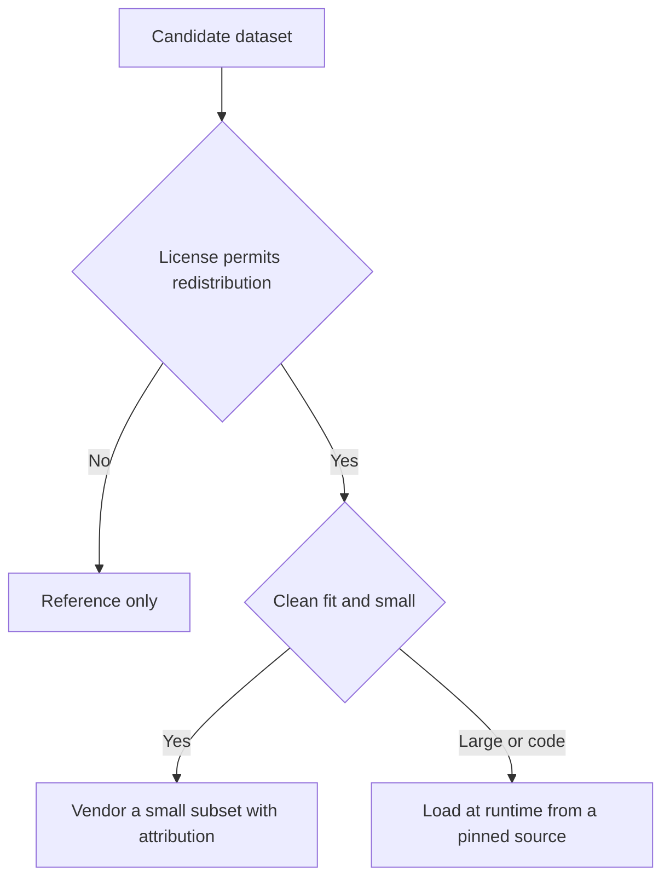

# Datasets

**Purpose.** List the benchmark datasets we reviewed for agent-attack testing, their licenses, and how
(or whether) modelWrecker may use each one. A benchmark dataset here is a public collection of attack
and sometimes benign samples that others use to measure an attack or a defense.

**The rule, first.** We do not bundle a dataset whose license does not clearly permit redistribution
for commercial use. We prefer **loading at runtime from a pinned source** (a specific commit or
revision) over copying data into the repository. We keep large datasets out of the core package. And
we add benign controls so we can measure false positives. A benign control is a matched sample with no
attack in it; if the target "fails" on it, the result is a false positive, not a finding.

Two of these are now built: **InjecAgent** (MIT) and **AgentInjectionBench** (Apache-2.0) load at
runtime from a pinned commit through `src/modelwrecker/datasets/`, cached locally, never bundled. Run
`modelwrecker datasets` to list them and `modelwrecker datasets <name>` to fetch and validate one. Set
`MODELWRECKER_DATASETS_OFFLINE=1` to forbid downloads (a cached copy is then required). The others
remain reference-only or planned, as the table says. No dataset is bundled into the PyPI package or
the Docker image.

This page pairs with [`research/research-sources.md`](research/research-sources.md) and
[`research/incident-to-strategy.md`](research/incident-to-strategy.md).

## The candidates

"Code / data" licenses are listed separately because some projects license their code but not their
data. "Samples (verified)" are counts we confirmed at the verified version. "Redistribution" says
whether we may ship the data. "Integration method" and "Recommendation" describe the **planned**
approach.

| Dataset | Official repository | License (code / data) | Latest verified version | Main coverage | Samples (verified) | Integration method | Redistribution | Recommendation |
|---------|---------------------|-----------------------|-------------------------|---------------|--------------------|--------------------|----------------|----------------|
| InjecAgent | github.com/uiuc-kang-lab/InjecAgent | MIT / MIT | commit f19c9f2, 2024-07-02, no tags | Indirect injection against tool-using agents, direct-harm and data-stealing settings | 1,054 per setting: 510 direct-harm plus 544 data-stealing, across 2 settings (base, enhanced) | Built: loads at runtime from pinned commit f19c9f2 via `datasets/injecagent` | Allowed with the MIT notice | Built (load at runtime, not bundled) |
| MCPTox | github.com/zhiqiangwang4/MCPTox-Benchmark | none / none | commit f85189f, 2025-12-03, no tags | MCP tool poisoning across many servers | 1,348 instances, 1,312 valid, 45 servers | Raw files, download only (planned) | Not allowed, no license | Reference only |
| AgentInjectionBench | github.com/ppradyoth/AgentInjectionBench and HF ppradyoth/AgentInjectionBench | Apache-2.0 / Apache-2.0 | tag v0.1.0, 2026-09-09; main 325c3ce, 2026-10-09, pyproject 0.2.0; not on PyPI | Indirect-injection scenarios that map to tool_misuse, rag_injection, mcp_tool_poisoning | 182 total: 142 attacks plus 40 benign | Built: loads at runtime from pinned commit 325c3ce via `datasets/agent_injection_bench` | Allowed, keep the Apache-2.0 notice | Built (load at runtime, not bundled) |
| AgentDojo | github.com/ethz-spylab/agentdojo, PyPI agentdojo | MIT / MIT, data ships in the package | PyPI and tag 0.1.35, 2025-10-27; main 089ed46, 2026-06-02 | Agent user tasks plus injection tasks across simulated environments | v1 to v1.1.2: 97 user tasks, 27 injection tasks, 629 pairs. v1.2 to v1.2.2: 97 user, 35 injection, 949 pairs | pip package, code plus environments (planned, optional extra) | MIT allows it, but it is code, not data | Load at runtime from a pinned source, optional extra |
| Contemporary Agent Attacks | github.com/AndrewSispoidis/contemporary-agent-attacks | none / claimed CC BY 4.0, GitHub reports NOASSERTION | commit ca781be, 2026-09-26, no tags | Single-turn attack text plus negatives, a classifier corpus | 533 attacks, 102 held out, plus 1,187 negatives | Raw files at a pinned commit (planned) | Claimed with attribution, but provenance is a problem | Reference only |
| Tensor Trust | github.com/HumanCompatibleAI/tensor-trust-data, HF mirror qxcv/tensor-trust | game code BSD-2-Clause / none | commit 747a75e, 2024-03-17 | Prompt hijacking and system-prompt extraction from a game | hijacking 776, extraction 570, extraction detection 230 | Raw files or Hugging Face (planned) | Not allowed, no data license | Reference only |
| HarmBench | github.com/centerforaisafety/HarmBench | MIT / MIT repo, multimodal images are third-party | commit 8e1604d, 2024-08-05, no tags, not on PyPI | Harmful-behavior prompts, text and multimodal | text 400: val 80, test 320; multimodal 110 | Raw CSV at a pinned commit, text only (planned) | Text CSVs allowed with the notice; do not ship images; do not load the pickled hashes | Load at runtime from a pinned source, text only |
| JailbreakBench | github.com/JailbreakBench/jailbreakbench, PyPI jailbreakbench, HF JailbreakBench/JBB-Behaviors | MIT / MIT | PyPI and tag v1.0.0, 2024-06-13; HF revision 886acc3, 2024-09-26 | Harmful and benign behaviors plus a judge-comparison set | 100 harmful plus 100 benign; 300 judge comparison | Hugging Face datasets at a pinned revision (planned); avoid the pip package, it pins python below 3.12 | Allowed with the MIT notice | Load at runtime from a pinned source |

## What we will use first

The best first fits for our indirect-injection work are **AgentInjectionBench** (Apache-2.0) and
**InjecAgent** (MIT). Both are license-clean against our Apache-2.0 project, and both will be loaded at
runtime from a pinned source rather than bundled. AgentInjectionBench's schema maps directly onto our
`tool_misuse`, `rag_injection`, and `mcp_tool_poisoning` strategies, and its 40 benign cases suit judge
calibration; it is small, synthetic, and alpha, so we plan to vendor only a small subset with
attribution. InjecAgent has a quote-wrapping artifact in its tool responses that we will strip before
use, and it ships no official benign set, so we will supply our own controls.

**MCPTox** and **Tensor Trust** are reference-only: neither has a license that permits redistribution,
so we may read and learn from them but not ship their data. **HarmBench** and **JailbreakBench** have
MIT-licensed text we can use with our own judge; we will not ship HarmBench's multimodal images and
will not load its pickled hashes, and for JailbreakBench we will pull the data from Hugging Face at a
pinned revision rather than the pip package. Their official judges need a GPU or a paid judge API, so
we use modelWrecker's own judge against the free text instead.

To repeat the status plainly: all of the above is the documented plan. None of this dataset loading,
vendoring, or adapter code exists yet. See [`DEPENDENCIES.md`](DEPENDENCIES.md) and
[`../ROADMAP.md`](../ROADMAP.md) for where this work is tracked.

## Related docs

- [`research/research-sources.md`](research/research-sources.md) - the sources and how we verify them.
- [`research/incident-to-strategy.md`](research/incident-to-strategy.md) - incidents to safe tests.
- [`research/oss-landscape.md`](research/oss-landscape.md) - the wider reuse-or-build survey.
- [`DEPENDENCIES.md`](DEPENDENCIES.md) - every external dependency and why we keep it.
