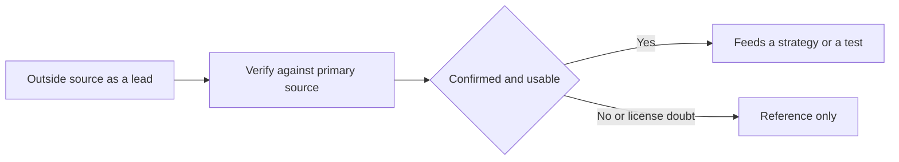

# Research: sources for agent-attack strategies

This note lists the outside sources we reviewed while building modelWrecker's agent-attack
strategies, and how we treat them. The short version: we treat every outside source as a **lead to
verify**, never as proof. A list of incidents or a dataset README is a starting point. A strategy only
ships once we have confirmed the underlying weakness against a primary source (the original advisory,
CVE record, or paper).

This sits beside the other Phase 0 research notes: the OSS landscape
([`oss-landscape.md`](oss-landscape.md)) and the security taxonomies ([`taxonomies.md`](taxonomies.md)).
For how a verified incident becomes a test, see
[`incident-to-strategy.md`](incident-to-strategy.md).

## How we verify a claim

A claim is a weakness, a statistic, or an attack technique that a source asserts. Before we rely on
one, we check it against the **original** source, not an index that points at it.

- Trace every claim to a primary source: the vendor advisory, the CVE record, the research blog post
  by the finder, or the paper itself. An index entry or a news article is a pointer, not the proof.
- If the primary source does not contain the claim, we mark the claim unverified and do not use it.
  For example, the incident index below attributes a "5.5% / 33%" tool-poisoning statistic to a
  vendor post that contains no such numbers, so we drop that statistic.
- We prefer the finder's own write-up and the official CVE or MSRC entry over a secondary re-telling.
- We note license and provenance doubts openly, because a source we cannot redistribute or trust is
  reference-only (we can read it and learn from it, but not ship from it).

## Incident indexes we reviewed

These are curated lists of agent-attack incidents. We use them to find leads, then verify each lead
on its own. We do not treat their counts, statistics, or labels as facts.

| Source | What it is | License | How we use it |
|--------|------------|---------|---------------|
| webpro255/awesome-ai-agent-attacks | A curated index of 336 agent-attack entries, mostly links to secondary news sites. Dates are often month and year only. It has no entry for the GitHub MCP or Supabase MCP incidents. | MIT | A lead index only. We verify each entry against its primary source. Its README "Key Statistics" are attributed to a vendor post that does not contain them, so we do not use those numbers. |
| AndrewSispoidis/contemporary-agent-attacks | A classifier or firewall text corpus: 533 single-turn attack text files plus 1,187 negative (benign) samples. It is not a set of agent scenarios. | Repo LICENSE says CC BY 4.0, but GitHub reports NOASSERTION | Reference only, for seed text and judge false-positive calibration, with attribution. We do not treat it as agent scenarios. See the caveats below. |

Honest caveats for these indexes:

- The awesome index sources most entries from secondary news links (for example thehackernews and
  theregister), and its headline statistics are unverified against the posts it cites.
- contemporary-agent-attacks has provenance and license doubts. Its negatives appear to derive from
  Stack Overflow text, which is CC BY-SA and cannot be relicensed as CC BY 4.0, so the stated license
  does not hold for the whole corpus. Internal counts disagree, the `sources/` directory is missing,
  and the corpus is vendor-run (the vendor's own classifier tops its own leaderboard). We keep it as
  reference material only.

## Existing tools we evaluated

Before building an in-house strategy we check for a maintained, permissively licensed project that
fits behind our interface and runs offline. Here is the result for agent-attack tooling. "Local or
offline" means it can run without calling a hosted service. "Paid service needed" means some core
feature requires a paid or hosted backend.

| Tool | License | Local or offline | Paid service needed | Verdict |
|------|---------|------------------|---------------------|---------|
| promptfoo | MIT | Partly; its agent, MCP, RAG, and indirect-injection plugins are remote-only | Yes, for those plugins; telemetry on by default | Borrow the idea only |
| Wallbreaker | AGPL-3.0-or-later | Yes | No | Do not use |
| AgentDojo | MIT | Yes | No | Integrate later via a small optional adapter, benchmark only |
| Snyk Agent Scan | Apache-2.0 | Only its `inspect` step is local; analysis needs a token and a remote API | Yes | Borrow the idea only |
| DeepTeam | Apache-2.0 | Yes | No, the hosted service is optional | Borrow the idea only |
| PyRIT | MIT | Yes | No | Already integrated; extend with its cross-domain injection workflow later |

Notes on the verdicts:

- Wallbreaker is AGPL-3.0, which our rules forbid us from copying into an Apache-2.0 codebase, and its
  upstream repository has vanished. We do not use it.
- Snyk Agent Scan (formerly the Invariant mcp-scan tool) needs a token and a remote API for its real
  analysis, so it does not fit our offline rule.
- DeepTeam overlaps with PyRIT and garak, which we already integrate, and it is LLM-judged rather than
  behavior-confirmed, so we take ideas from it rather than a dependency.

### Why indirect_prompt_injection is built in-house

We build the `indirect_prompt_injection` strategy ourselves because the closest existing tools do not
fit our two hard rules: test the user's own configured target, and run offline with free parts.
promptfoo's agent, MCP, and indirect-injection plugins are remote-only; they call promptfoo's hosted
API, which breaks our offline and egress rules. AgentDojo swaps in its own simulated environment
rather than testing the target the user configured, so it answers a different question. Neither is a
fit for "test the configured target, offline, free", so the strategy is first-party. See
[`../attack-engine/STRATEGIES.md`](../attack-engine/STRATEGIES.md) and
[`incident-to-strategy.md`](incident-to-strategy.md).

### What we borrow

- From promptfoo and DeepTeam we borrow the **plugin taxonomy** as a checklist of future strategy
  objectives (for example role and access control abuse, tool discovery, cross-session leaks, memory
  poisoning, RAG poisoning, and coding-agent sandbox or egress tests). The checklist guides what to
  build next; the code stays ours.
- From PyRIT we plan to add its **cross-domain injection (XPIA) workflow** when we next touch the
  PyRIT adapter. This adds no new dependency, because PyRIT is already integrated.

## Related docs

- [`incident-to-strategy.md`](incident-to-strategy.md) - how a verified incident becomes a safe test.
- [`../datasets.md`](../datasets.md) - candidate benchmark datasets and their licenses.
- [`oss-landscape.md`](oss-landscape.md) - the wider reuse-or-build survey.
- [`taxonomies.md`](taxonomies.md) - the taxonomies we map findings to.
