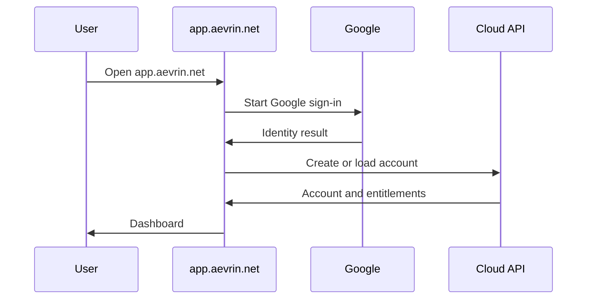
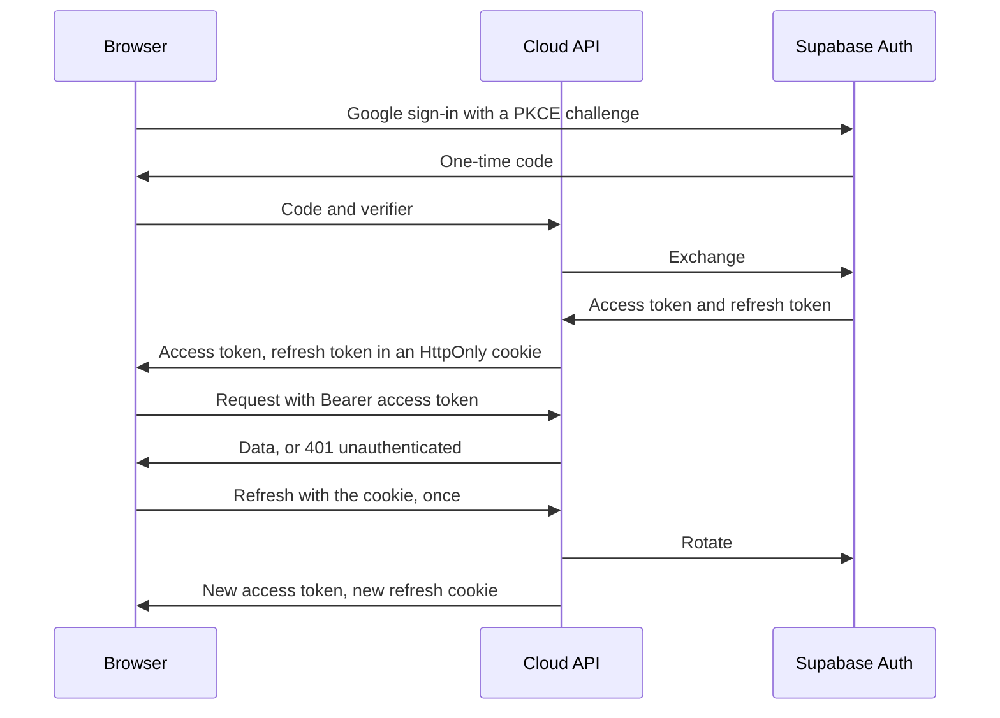
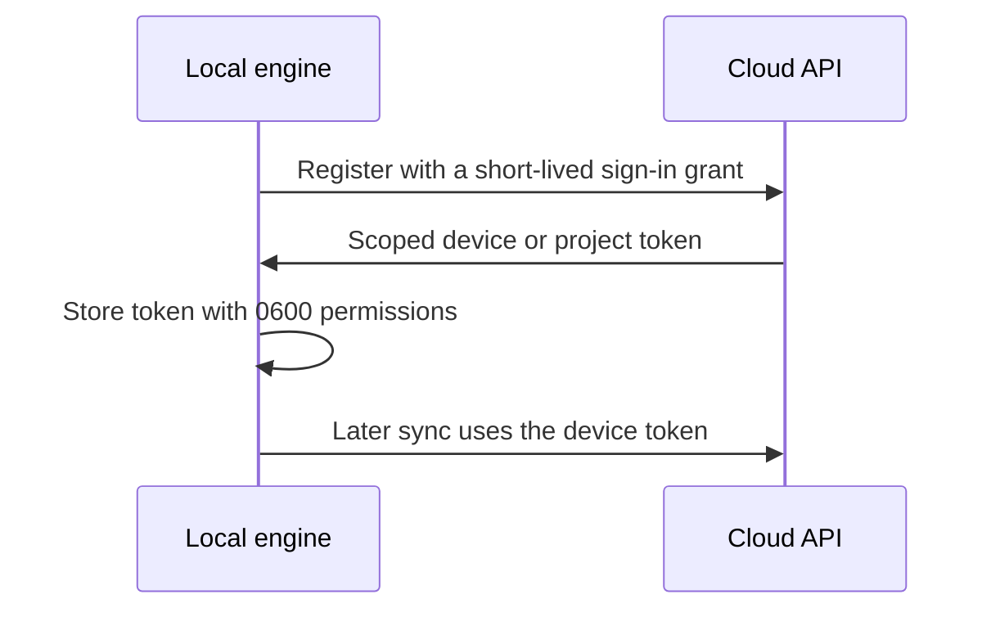
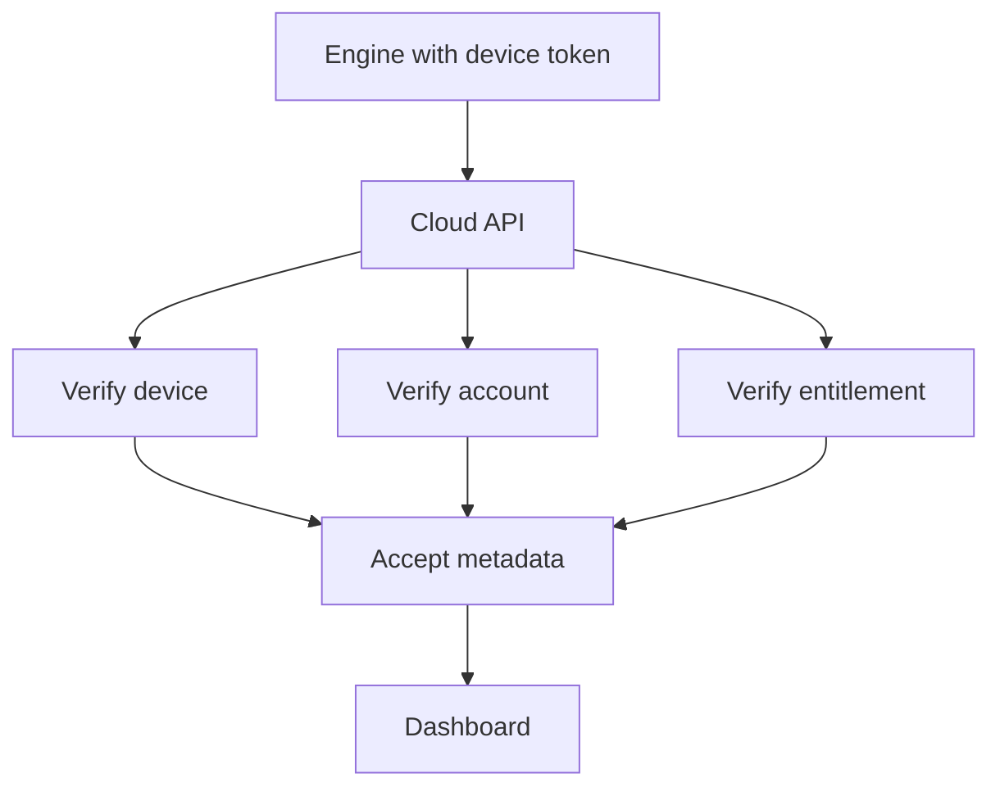

# Authentication

> Read [`SECURITY.md`](SECURITY.md) first. This page is the single source of truth for how users and
> devices prove who they are. The cloud side is in [`../architecture/cloud-control-plane.md`](../architecture/cloud-control-plane.md);
> the credential decision is [`../decisions/ADR-0017-device-credential-model.md`](../decisions/ADR-0017-device-credential-model.md).

## Purpose

There are two things to authenticate: the **user** signing in to the dashboard, and the **device** (a
local install of the engine) syncing results. They use different credentials on purpose, so a problem with
one does not expose the other.

## User sign-in with Google

Users sign in with Google using OAuth and OIDC (OpenID Connect, the identity layer on top of OAuth that
tells the app who the user is). modelWrecker never sees or stores the user's Google password.



Rules:

- Never store Google passwords. Only the identity Google returns is used.
- Use OAuth and OIDC correctly: verify the token, check the audience, and keep sessions short.
- Keep user sign-in separate from the local engine. The engine never handles the Google flow.

### How the dashboard does it

The dashboard (`src/dash`) has two build modes, set by `VITE_API_MODE`:

- **mock** (the default): sample data, no sign-in. Used for local development and the demo.
- **http**: real Google sign-in through Supabase Auth, then the real control-plane API
  ([`../architecture/control-plane-api.md`](../architecture/control-plane-api.md)).

In http mode:

- Sign-in uses the PKCE flow (the browser proves it started the sign-in, so a stolen redirect code is
  useless). Google returns to `/dashboard/`, the dashboard hands the one-time code to the API once, cleans
  the address bar, and returns the user to the page they started from.
- Every API call sends `Authorization: Bearer <access token>` from the page's memory.
- A `401 unauthenticated` from the API refreshes the session once and retries the request once. If the
  refresh fails, the user is signed out of that browser and sees the sign-in screen. See below.
- Error text shown to the user comes only from the API's `message` field, never a raw response.
- The build needs `VITE_SUPABASE_URL`, a public value: the address where Google sign-in starts. If it is
  missing, the dashboard shows a configuration screen instead of starting. No key of any kind goes in the
  dashboard.

### Access and refresh tokens

Supabase Auth issues, rotates, and checks the dashboard's tokens. modelWrecker does not run a second token
system. The control-plane API makes the token calls for the browser, so the refresh token never reaches
script on the page. The decision is [`../decisions/ADR-0021-refresh-token-cookie.md`](../decisions/ADR-0021-refresh-token-cookie.md).



- **Access token.** A short-lived signed JWT (JSON Web Token) that names the user and the session. It holds
  no secrets and no profile data beyond what Supabase puts in by default. It lives only in the page's
  memory and is gone when the tab closes. Every user route sends it as `Authorization: Bearer`. The API
  checks it with Supabase Auth on every request, so a signed-out or revoked session stops working at once,
  not when the token expires. The API then refuses a suspended account and queries the database as that
  user, so row-level security applies.
- **Refresh token.** Long-lived and single use. Supabase Auth stores it, rotates it on every refresh, and
  when an old one is used again after the short reuse window, revokes the whole session. In the browser it
  lives only in the `__Secure-mw_rt` cookie: `HttpOnly` (no script can read it), `Secure`,
  `SameSite=Strict`, and sent only to `/api/v1/auth`. It lasts 30 days from the last refresh.
- **The auth routes.** `POST /api/v1/auth/session`, `/refresh`, and `/logout`
  ([`../architecture/control-plane-api.md`](../architecture/control-plane-api.md)). They are the only
  routes that read a cookie, so they refuse any request without the `X-Aevrin-Auth: 1` header, from another
  origin, or marked cross-site (cross-site request forgery). They are rate limited per address. A Supabase
  outage answers `503` and keeps the cookie; anything else that fails ends the session and clears it.
- **Refresh in the browser.** The dashboard refreshes a minute before expiry, and on a page load. If the
  API still answers `401 unauthenticated`, the request refreshes once and retries once
  (`src/dash/src/api/session.ts`). Requests rejected together share one refresh, and tabs take turns (a
  browser lock), because every tab shares the one cookie. A second rejection, or a failed refresh, signs
  the browser out. Nothing can loop.
- **Sign-out.** Revokes this session at Supabase Auth (other devices stay signed in), then clears both
  cookies. If the access token has already expired, the API refreshes first to prove the session.
- **Cross-site scripting.** A script injected into the page could still use the session while the page is
  open, but it cannot read or carry off the refresh token. The Content-Security-Policy
  ([`SECURITY.md`](SECURITY.md)) limits which scripts can run at all.
- **Signed-in visitors.** Sign-in also sets `mw_signed_in=1`, a cookie with no secret in it that the landing
  page can read. Opening `app.aevrin.net/` with it goes straight to `/dashboard/` (a check in the landing
  page's `index.html`, before anything renders). If the session has ended, the dashboard shows its sign-in
  screen. A link to a landing section, such as `/#pricing`, or a link from the site itself still shows the
  landing page.
- **Browsers signed in before the cookie.** An older dashboard kept the Supabase session in
  `localStorage`. On its next visit the dashboard sends that refresh token to `/auth/refresh` once, which
  moves the session into the cookie, and deletes the stored copy.

The Supabase Auth project settings this relies on. Check them, and set them with `--apply`, using
`deploy/supabase/auth-settings.mjs` and your own Supabase personal access token:

| Setting | Value |
| --- | --- |
| Access token (JWT) expiry, `jwt_exp` | 3600 seconds or less |
| Refresh token rotation, `refresh_token_rotation_enabled` | On |
| Refresh token reuse interval, `security_refresh_token_reuse_interval` | 10 seconds |
| Token refresh rate limit, `rate_limit_token_refresh` | 1800 per 5 minutes or more, because every refresh now comes from the API Worker's address |

## Device credential

Each local install registers once as a device and receives a **scoped device or project token**. This is
what the engine uses to sync. It is not the user's Google token, and the Google token never enters the
container.



Why a separate token:

- It is **scoped**: it can sync results and read the current entitlement for its project, and nothing more.
- It can be revoked per device without signing the user out everywhere.
- If a device token leaks, it cannot be used to sign in as the user or touch billing.

## CLI sign-in

The CLI signs in with the OAuth 2.0 device authorization grant (the flow where a command-line tool shows a
code and the user approves it in a browser). It stores the resulting token with `0600` permissions. For
continuous integration, where a browser is not available, the `MODELWRECKER_DEVICE_TOKEN` env var carries
the device token instead. This is the Phase 10.4 work in [`../../ROADMAP.md`](../../ROADMAP.md),
implemented in `src/modelwrecker/cloud` (`modelwrecker login`, `logout`, `sync`; see
[`../reference/CLI.md`](../reference/CLI.md)).

The approval half lives on the dashboard Connect page (`/dashboard/connect`). The user code from
`modelwrecker login` arrives in the `?code=` link or is typed in as `XXXX-XXXX`. The user picks a project
and approves or denies. The page warns to approve only a code the user started, because a code sent by
someone else would link their engine to this account.

Engine-side token rules:

- The token is never printed or logged. The redactor masks any `mwd_...` value and any field named
  `device_token`.
- The cloud API URL must be https (plain http only for `localhost` and `127.0.0.1`), and the client
  never follows redirects, so the token cannot be bounced to another host.
- A saved credential is only sent to the URL it was issued for.

## Local-to-cloud connection

When the engine connects, the cloud verifies the device, the account, and the entitlement before accepting
any metadata.



The engine stays usable offline where practical; it does not need a live connection for every attack. See
[`entitlements.md`](entitlements.md) and [`../architecture/data-flow.md`](../architecture/data-flow.md).

## What the engine never holds

```text
the user's Google password
the user's Google access or refresh token
Razorpay secrets
any other account-level secret
```

Billing secrets live only in the cloud control plane. See [`../billing/razorpay.md`](../billing/razorpay.md).

## Failure cases

- Invalid or revoked device token: sync is refused; the engine keeps results locally.
- Expired access token: the dashboard refreshes the session and carries on.
- Supabase Auth unreachable: refreshes answer `503` and keep the cookie, so the session resumes afterwards.
- Ended session (refresh token expired, revoked, or reused): the dashboard asks the user to sign in
  again; local runs are unaffected.
- Google unreachable: users cannot sign in to the dashboard, but a device that already has a token and a
  current signed entitlement keeps working offline.

## Security considerations

- Any network surface requires auth from day one, with anti-CSRF on mutating routes, per
  [`SECURITY.md`](SECURITY.md).
- Tokens are stored with restrictive permissions and redacted from logs and evidence.
- Hosted-platform credentials live only in local untracked files and the deploy secret store, never in the
  repo or in docs. This repo is published.

## Decisions

- Device credential model: [`../decisions/ADR-0017-device-credential-model.md`](../decisions/ADR-0017-device-credential-model.md).
