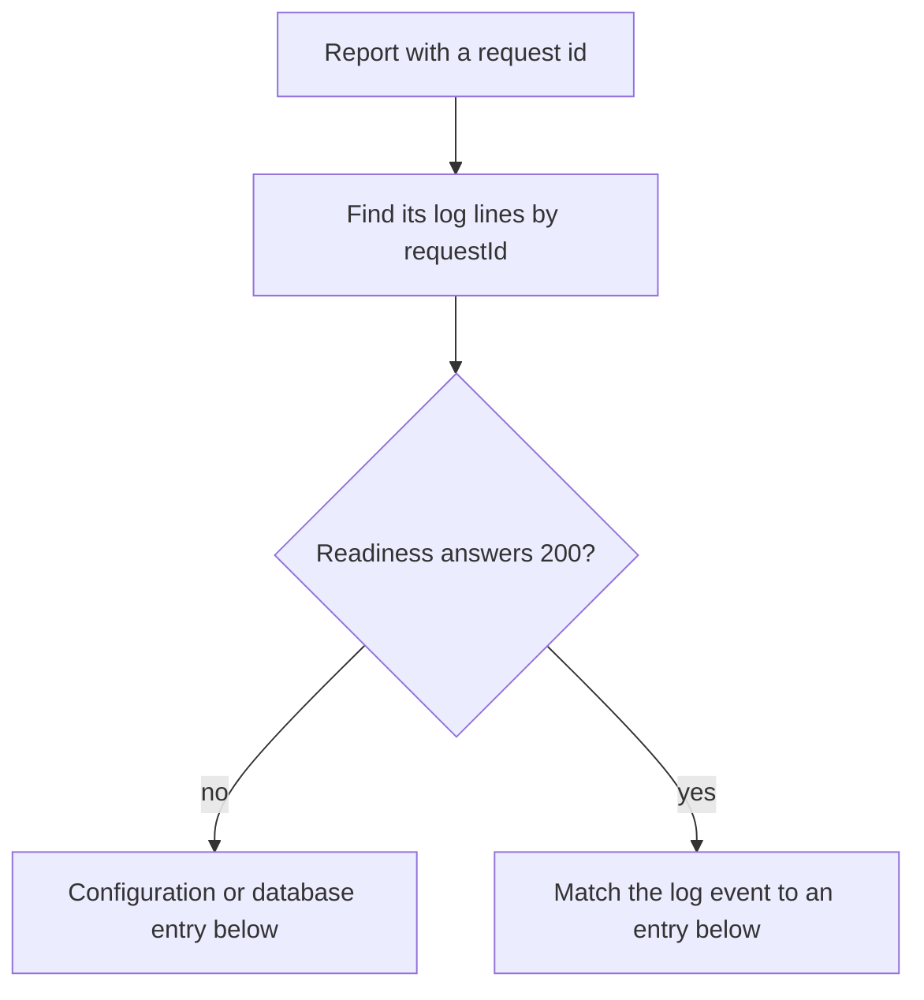

# Incident runbook

What to do when the hosted service misbehaves: the dashboard at `vyra.aevrin.ai`, its API, or the CLI's
cloud calls. Each entry says how to spot the problem, how to confirm it, what to do, and how to know the
fix worked.

The engine itself runs on the user's machine and needs none of this. A cloud outage never stops a local
run: results that cannot sync wait in the local outbox and go up on a later `modelwrecker sync`.

## Start with the request id

A person who hits a server error sees a reference in the message:

- the dashboard: `... Reference: 8a1b2c3d4e5f6789-SIN.`
- the CLI: `... (request id 8a1b2c3d4e5f6789-SIN)`

The id is Cloudflare's ray id for that request. In the Cloudflare dashboard, open Workers & Pages,
Observability, and filter `$workers.event.request.headers.cf-ray` equal to the id: that finds the
request itself (its path, status, and any log lines). Unexpected failures also write their own line with
the field `requestId`, and a database failure adds `operation`, the query that broke (for example
`payments.fulfil`). A new request takes about half a minute to show up. To watch live instead:

```bash
cd src/api
npx wrangler tail aevrin-api --format pretty --search "<request id>"
```

Then check whether the service can do its job at all:

```bash
curl -s https://vyra.aevrin.ai/api/v1/health/ready
```

`{"ok":true,...}` means the Worker runs and the database answers.



The log events are listed in [`../architecture/control-plane-api.md`](../architecture/control-plane-api.md#errors-timeouts-and-retries).

## Every request answers 503 "unavailable"

- Spot it: every route answers `503 unavailable`, even `/api/v1/health`.
- Confirm: the log event `config_invalid` names the setting, for example `SUPABASE_URL is not set`.
- Fix: set the secret again. A secret takes effect without a redeploy.

  ```bash
  cd src/api
  npx wrangler secret put SUPABASE_URL
  ```

  `APP_ORIGIN` is not a secret: change it in `src/api/wrangler.toml` and redeploy.
- Check: `/api/v1/health` answers 200.

## Requests answer 503 "service_unavailable"

- Spot it: the log events `request_unavailable` and `readiness_database_failed`, and
  `/health/ready` answers 503.
- Confirm: open the `modelWrecker` project in the Supabase dashboard. Check that it is running and
  not paused, and check status.supabase.com.
- Fix: restore the project, or wait for Supabase to recover. The API needs no change: it answers 503
  so the dashboard and the CLI try again later.
- Check: `/health/ready` answers 200.

## Payments fail with 502 "payment_provider_error"

- Spot it: the log event `payment_provider_failed`, with `providerStatus` and `providerCode`.
- Confirm: a `providerStatus` of `0` means Razorpay did not answer in time, `401` means the key
  pair is wrong, and a `5xx` means Razorpay is having trouble (status.razorpay.com).
- Fix: for `401`, set `RAZORPAY_KEY_ID` and `RAZORPAY_KEY_SECRET` again as a matching pair (both
  live or both test). For `0` or a `5xx`, wait. An order that failed to create charges nothing.
- Check: the next checkout reaches the Razorpay window.

## A customer paid but did not get the plan

The scheduled check for unpaid orders was removed (#83), so this is a manual step.

1. Ask the customer to open the Billing page. It asks Razorpay about their unpaid orders from the last
   24 hours and applies any that were paid.
2. If the payment is older than 24 hours, or is still missing, find it in the Razorpay dashboard and
   confirm it is captured.
3. In the admin console, add the amount paid as account credit for that customer, with the Razorpay
   payment id as the reason. Credit is applied at checkout, and when it covers the whole price the
   purchase completes without Razorpay.
4. Ask the customer to buy the plan again.

Before step 3, search the logs for `payment_order_mismatch`. It means a payment's amount, currency, or
order did not match, so it was deliberately not applied. Find out why before you credit anything.

## Razorpay webhooks are rejected

- Spot it: the log event `payment_webhook_signature_rejected`.
- Fix: the webhook secret in the Razorpay dashboard (Settings, Webhooks) and the Worker secret
  `RAZORPAY_WEBHOOK_SECRET` must be the same value. Set it again in both places.
- Payments still work in the meantime: checkout verification and the Billing page apply them. See
  [`../billing/razorpay.md`](../billing/razorpay.md).

## A deploy broke something

Roll back first, then fix it properly.

- The API Worker: `npx wrangler rollback` inside `src/api` returns to the previous version.
- The site: in the Cloudflare dashboard, open Workers & Pages, `modelwrecker-app`, Deployments, and
  roll back to the last good deployment.
- Then revert the pull request on GitHub. CI deploys the revert. A rollback on its own is undone by
  the next deploy from `main`.

## A secret leaked

Rotate it where it was issued, then set the new value with `npx wrangler secret put <NAME>`. Never paste
a secret into an issue, a chat, or a log. Two secrets need extra care:

- `ENTITLEMENT_SIGNING_KEY`: the engine ships the matching public key, so a new key needs an engine
  release first. See [`../security/entitlements.md`](../security/entitlements.md).
- `ADMIN_TOTP_KEY`: replacing it means every admin enrolls their authenticator again.

## Data and backups

Accounts, runs, and payments live in the Supabase project `modelWrecker`. Check which backups the
project's plan includes in the Supabase dashboard. A restore has not been tested for this project yet.
Test one on a scratch project before you need it: a backup that has never been restored is not yet a
recovery plan.

## After any incident

- Confirm `/health/ready` answers 200 and that a sign-in works.
- Record what happened, the request ids, and the fix in a GitHub issue
  ([`../reference/GIT-WORKFLOW.md`](../reference/GIT-WORKFLOW.md)).
- If a step on this page was wrong or missing, fix the page in the same pull request.
